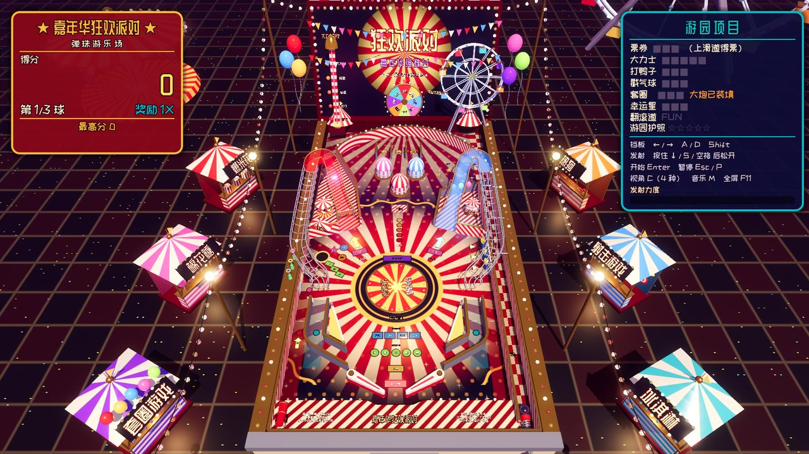
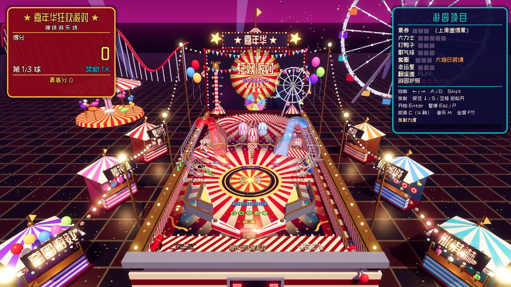
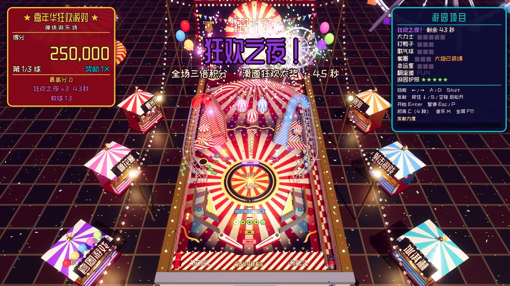
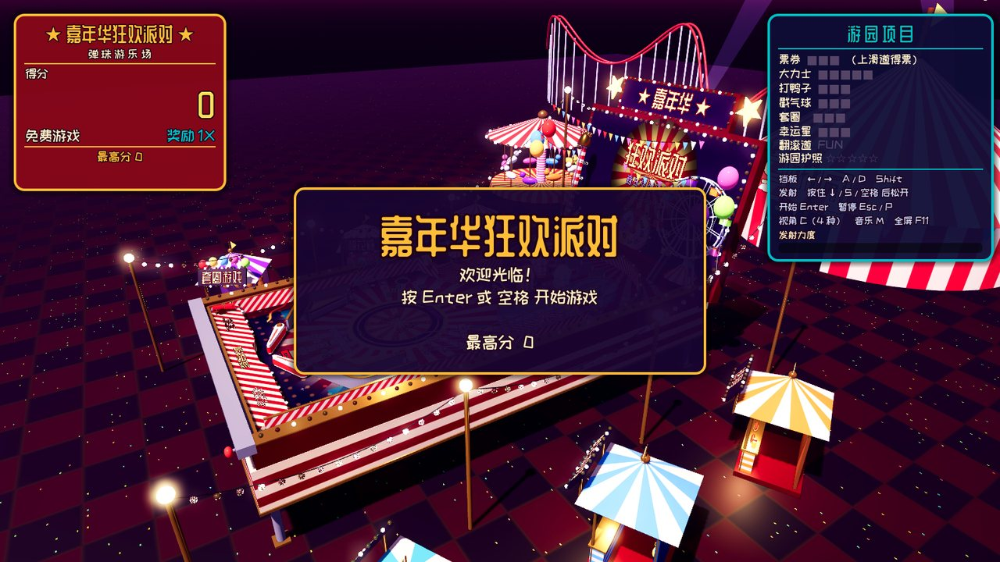

# 🎪 嘉年华狂欢派对弹珠台 · Carnival Party Pinball

一款用 **Godot 4** 制作的 **2.5D 弹珠台（Pinball）** 游戏：3D 渲染 + 真实刚体物理，斜视角镜头，
主题是美式嘉年华 / 游乐园狂欢派对。整台机器摆在一个夜晚的游乐场中央：四周是爆米花、棉花糖、
热狗、射击、套圈、冰淇淋摊位，头顶挂着彩灯串，远处有马戏团大帐篷、巨型摩天轮、旋转木马、
过山车、探照灯和不停绽放的烟花。游戏内文字全部为中文。



| 低角度视角 | 「狂欢之夜」巫师模式 |
| --- | --- |
|  |  |



> 模型、贴图、音效和音乐全部由代码程序化生成；唯一的外部素材是两款开源中文字体（见下文）。

## 运行

1. 安装 **Godot 4.4 或更高版本**（开发与测试使用 4.6.2；需要 4.4+ 内置的 Jolt 物理引擎）。
2. 用 Godot 打开本目录下的 `project.godot`。
3. 按 **F5** 运行。（`scenes/main.tscn` 在编辑器里是空节点，台面和游乐场在运行时由脚本生成。）

## 操作

| 按键 | 功能 |
| --- | --- |
| `←` / `A` / `Z` / 左 Shift | 左挡板 |
| `→` / `D` / `/` / 右 Shift | 右挡板 |
| 按住 `↓` / `S` / `空格`，松开发射 | 弹簧发射器（按住越久力度越大） |
| `Enter` | 开始游戏 |
| `Esc` / `P` | 暂停 |
| `C` | 切换镜头：街机 / 低角度 / 俯视 / 跟随 |
| `M` | 音乐开关 |
| `F11` | 全屏 |
| 手柄 | LB/RB 挡板，A 发射，Start 开始 |
| 触屏 | 左半屏/右半屏 = 左/右挡板，右下角按住 = 发射 |

## 台面布局

```
            ┌──────────── 顶部弧形轨道 ────────────┐
            │       F   U   N  翻滚道   ★幸运星★    │  ← 技巧球（闪烁那条道）
            │   (粉)棉花糖  (蓝)棉花糖   🎈🎈🎈      │  ← 3 个弹跳柱 / 气球靶
  过山车 ◢  │        (红)棉花糖                    │ ◣ 摩天轮
  塑料滑道  │  [旋转木马]  [打我！]大力士 [爆米花车] │   塑料滑道
  +金属轨道 │🎟售票亭                         🦆🦆🦆│   +金属轨道
  套圈 🍾🍾🍾│        ◎ 旋转木马转盘 ◎              │
            │   ◥弹弓     游园护照 ★★★★★  弹弓◤   │
            │外道|内道 ╲挡板    挡板╱ 内道|外道      │ ┃发射道
            │💣大炮                                 │
            └──────────────────────────────────────┘
```

## 得分点

| 元素 | 规则 | 分数 |
| --- | --- | --- |
| **过山车滑道（左）/ 摩天轮滑道（右）** | 半透明塑料坡道，爬升、U 形掉头后接金属线轨绕回同侧内道，正好接着打另一边 | 5,000；4 秒内连续上滑道为连击 ×2、×3… |
| **大力士 High Striker** | 正面击中中央「打我！」靶，背箱上的冰球升一级，第 5 下敲钟 | 1,000×等级；敲钟 50,000 |
| **打鸭子** | 3 个落靶全部打倒 | 每只 750，全中 10,000 并点亮额外球 |
| **戳气球** | 右上方 3 个气球靶全部戳破 | 1,500 / 全破 10,000 + 奖励倍数 |
| **套圈** 🆕 | 左墙 3 个靶子，每中一个机柜边的酒瓶就套上一个圈 | 2,000 / 全中 20,000，并给大炮装填 |
| **幸运星** 🆕 | 右上角 3 颗星星滚轮 | 1,000 / 全亮 15,000，并点亮幸运大转盘 |
| **旋转木马转盘** 🆕 | 台面中央旋转的圆盘，会把滚过的球带着转一圈再甩出去 | 每次 2,500，每 5 次 25,000 |
| **大炮回弹** 🆕 | 装填后，球掉进左外道时大炮把球轰回台面（开局自带一发） | 5,000 |
| **售票亭** | 吸球孔，按优先级发奖：狂欢之夜 → 多球 → 幸运大转盘 → 额外球 → 神秘奖品 | 3,000 + 奖品 |
| **F-U-N 翻滚道** | 三条全亮奖励倍数 +1（最高 5X），挡板可左右轮换灯 | 500 / 5,000 |
| **技巧球** | 发射后第一下进闪烁的那条道 | 25,000 |
| **弹跳柱 / 弹弓 / 旋转片** | 弹跳柱越打分值越高 | 250+ / 50 / 每半圈 100 |
| **内道 / 外道** | | 1,000 / 2,500 |
| **救球** | 每颗球离开发射道后 10 秒内掉落会自动补发 | |
| **结算奖励** | 每颗球结束时：滑道、靶子、弹跳柱、翻滚道、敲钟次数 × 奖励倍数 | |

## 🌟 豪华得分（达成条件后拿高分）

| 玩法 | 怎么触发 | 奖励 |
| --- | --- | --- |
| **嘉年华多球** | 上滑道集满 3 张票，射进售票亭 | 3 球同时上场，每次上滑道 = **大奖** 50,000 起，每次 +10,000 |
| **双倍大奖** | 多球中，4 秒内左右两条滑道接连命中 | 第二次大奖 ×2 |
| **超级大奖** | 多球中，左右滑道的大奖都拿到后，射中大力士 | 当前大奖 **×3** |
| **限时抢分** | 大力士敲钟后 20 秒内射任意滑道 | 300,000 起，随时间递减到 50,000 |
| **双倍积分** | 旋转片累计每 40 圈，或转盘转到「双倍」 | 20–30 秒内所有得分 ×2 |
| **幸运大转盘** | 幸运星全亮后射售票亭，背箱上的转盘开始转 | 10万 / 25万 / 50万 / **100万** / 额外球 / 双倍积分 / 多球 / 大炮 |
| **游园护照** | 集齐 5 个章：大力士敲钟、打鸭子全中、气球全破、套圈全中、滑道 5 次 | 每个章 50,000 |
| **狂欢之夜（巫师模式）** | 护照集满后射售票亭 | 45 秒 3 球、**全场三倍积分**，每次滑道 300,000，结束时「狂欢总冠军」奖励 **1,000,000 + 本模式所得** |

每局 3 颗球，最高分保存在 `user://carnival_pinball.cfg`。

## 布景

- **机器本身**：糖果条纹围墙和金色压边、跑马灯（侧轨、顶部弧形、底部挡板、背箱、顶牌、转盘、摊位招牌）、
  背箱上旋转的摩天轮、大力士敲钟塔、幸运大转盘、「★ 嘉年华 ★」顶牌、彩旗、气球、金色机柜腿和发光投币门。
- **台面玩具**：会转的旋转木马（木马上下起伏）、爆米花车、套圈酒瓶、大炮（开炮有火光和硝烟），
  上滑道时还有一辆小过山车沿滑道飞驰。
- **游乐场**：6 个带灯牌的摊位、彩灯串和路灯、马戏团大帐篷、巨型摩天轮、旋转木马、过山车、3 道探照灯、
  夜空烟花（大奖和狂欢之夜时在台面上空绽放）、两盏扫过台面的彩色追光灯，待机时镜头环绕整个游乐场。

## 技术要点

- **2.5D**：游戏完全在 3D 中运行（Jolt 物理，240 Hz），滑道与线轨真实地把球抬离台面；镜头是带透视的斜俯视角，另有跟随镜头。
- **比例真实的重力**：1 单位 ≈ 5.4 cm（球直径 0.5），重力 180 单位/s²，台面倾角 6°（沿台面分量约 18.8），球贴着台面滚动，不会在挡板上乱跳。
- **挡板**：`AnimatableBody3D` 运动学刚体，带电磁线圈式加速（约 25 ms 达到满速），击球角度取决于球在挡板上的位置和出手时机——挡板尖附近出手可以打进对侧滑道。
- **滑道/线轨**：一条 Catmull-Rom 中心线扫掠出带圆角的 U 形槽，物理用 `ConcavePolygonShape3D`，入口 1.6 倍喇叭口；视觉前半段是半透明塑料，后半段是钢丝 + 箍圈的金属线轨。
- **旋转木马转盘**：对盘面上的球施加有上限、随球速衰减的切向摩擦力——慢球会被带着转，快速的挡板射门基本不受影响。
- **程序化美术**：台面图案、游乐场地面、条纹、灯泡都在着色器里计算；跑马灯是 GPU 驱动的 MultiMesh。
- **程序化音频**：`scripts/sfx.gd` 运行时合成所有音效（弹跳柱、铃铛、鸭子叫、大炮、烟花、转盘咔嗒声、"哇哇哇哇～"悲伤长号……）以及一首原创三拍子蒸汽风琴华尔兹；狂欢之夜时音乐会加速。
- **中文字体**：`fonts/ZCOOLKuaiLe-Regular.ttf`（站酷快乐体，完整版，用于界面）和 `fonts/ZCOOLQingKeHuangYou-Subset.ttf`（站酷庆科黄油体子集，用于招牌标题），均为 SIL OFL 开源许可（见 `fonts/OFL-*.txt`）。黄油体只保留了游戏里用到的字；增加新的中文文字后运行 `python3 tools/subset_fonts.py` 重新生成子集。缺字时会依次回退到快乐体和系统中文字体。

## 项目结构

```
project.godot            Jolt 物理、240Hz、倾斜重力等设置
scenes/main.tscn         入口场景（挂 game.gd）
scripts/game.gd          规则、计分、多球、豪华得分、救球、输入、镜头
scripts/table.gd         台面搭建：墙、滑道、线轨、靶子、转盘、大炮、灯、传感器
scripts/decor.gd         机柜、背箱、摩天轮、敲钟塔、幸运大转盘、顶牌、台面玩具、追光灯
scripts/midway.gd        游乐场环境：摊位、彩灯、大帐篷、巨型摩天轮、旋转木马、过山车、探照灯、烟花
scripts/hud.gd           界面（分数、游园项目进度、横幅消息）
scripts/sfx.gd           音效与音乐合成
scripts/geom.gd          程序化几何（墙、扫掠槽、管道、圆角）
scripts/mats.gd          共享材质、颜色、字体
scripts/elements/*.gd    球、挡板、发射器、弹跳柱、弹弓、落靶、立靶、旋转片、吸球孔……
shaders/*.gdshader       台面、地面、条纹、灯泡、太阳纹
fonts/                   中文字体与许可证
tools/subset_fonts.py    重新生成招牌字体子集
tests/sim.gd             无头物理测试 / 机器人试玩
tests/features.gd        新玩法与豪华得分规则测试
tests/shot.gd            截图脚本
```

## 无头测试

```bash
# 规则与新玩法（大炮、套圈、转盘、幸运星、多球大奖、限时抢分、双倍积分、狂欢之夜）
godot --headless --fixed-fps 240 --path . -s tests/features.gd

# 发射力度扫描 / 挡板出手位置 / 内道来球击打时机 / 直接射滑道 / 机器人试玩 10 分钟
godot --headless --fixed-fps 240 --path . -s tests/sim.gd -- plunge
godot --headless --fixed-fps 240 --path . -s tests/sim.gd -- aim
godot --headless --fixed-fps 240 --path . -s tests/sim.gd -- inlane
godot --headless --fixed-fps 240 --path . -s tests/sim.gd -- ramp
godot --headless --fixed-fps 240 --path . -s tests/sim.gd -- play

# 截图（需要显示环境，参数：输出目录 镜头编号 start）
godot --path . -s tests/shot.gd -- /tmp 0 start
```

## 调参入口

- 挡板力度/速度：`scripts/elements/flipper.gd`（`UP_SPEED`、`ACCEL`）
- 发射力度：`scripts/elements/plunger.gd`（`MIN_SPEED`、`MAX_SPEED`）
- 弹跳柱/弹弓踢力：`bumper.gd` / `slingshot.gd` 中的 `KICK`
- 滑道形状与高度：`scripts/table.gd` 的 `RAMP_CTRL`（左滑道中心线，右侧镜像），入口喇叭口 `FUNNEL`
- 转盘转速、大炮力度：`scripts/table.gd` 的 `disc_speed`、`KICK_SPEED`
- 规则数值：`scripts/game.gd` 顶部常量（球数、救球时间、多球所需票数、限时抢分、狂欢之夜时长、转盘奖品权重）
- 重力与倾角：`project.godot` 的 `physics/3d/default_gravity*`
